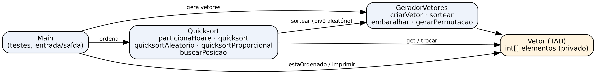
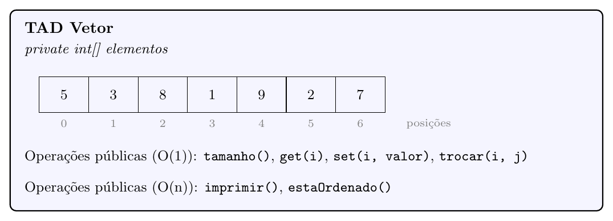
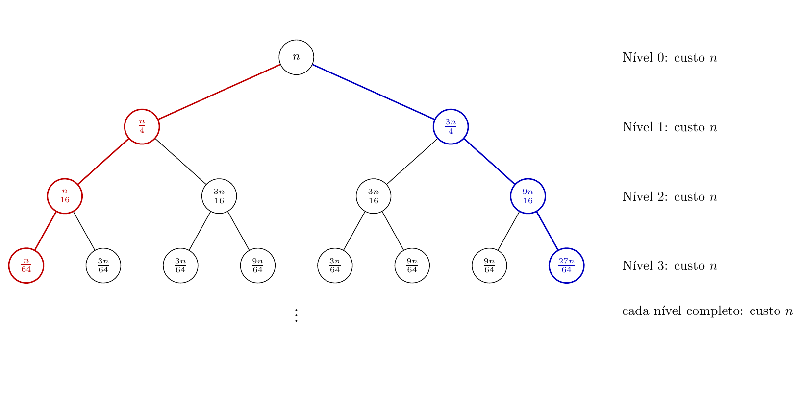

# A. Introdução

## O problema

O trabalho pede a implementação do algoritmo **QuickSort** em Java, sobre vetores de inteiros, em duas versões, e a análise de complexidade de tempo de cada uma:

1. **QuickSort com pivô aleatório**, analisado no caso médio, em que todas as partições são igualmente prováveis;
2. **QuickSort Proporcional**, que recebe um valor $\alpha$ e escolhe o pivô de forma a forçar a divisão $\alpha : (1-\alpha)$ em toda chamada. Foram escolhidos $\alpha = 1/4$ (partição 75/25) e $\alpha = 1/5$ (partição 80/20).

As duas versões usam o mesmo procedimento de particionamento, o de **Hoare**. Os vetores de entrada são permutações aleatórias dos inteiros de $1$ até $n$, sem repetição.

## Visão geral do programa

O programa é dividido em quatro classes, cada uma com uma responsabilidade:

| Classe | Responsabilidade |
|---|---|
| `Vetor` | Tipo abstrato de dados que encapsula o vetor de inteiros |
| `GeradorVetores` | Gera as permutações aleatórias de 1 a $n$ (Fisher-Yates) |
| `Quicksort` | Particionamento de Hoare e as versões do QuickSort |
| `Main` | Executa os testes e mostra os resultados |

O fluxo é simples: o `Main` pede ao `GeradorVetores` uma permutação de tamanho $n$, ordena com uma das versões do `Quicksort` e confere o resultado com `estaOrdenado()`.

Para compilar e executar, na pasta raiz do projeto:

```bash
javac -encoding UTF-8 -d bin src/*.java
java -cp bin Main
```

# B. Implementação

## B.1 Organização das classes

{width=100%}

## B.2 Estrutura de dados: o TAD `Vetor`

Em vez de passar um `int[]` diretamente entre as funções, foi criado o tipo abstrato de dados `Vetor`. O array fica **privado** dentro da classe, e todo acesso é feito pelas operações públicas. Assim, quem usa o vetor não depende de como ele é guardado por dentro (encapsulamento).

{width=85%}

| Operação | O que faz | Custo |
|---|---|---|
| `Vetor(int n)` | Cria um vetor com $n$ posições | $O(n)$ |
| `int tamanho()` | Devolve a quantidade de elementos | $O(1)$ |
| `int get(int i)` | Lê o elemento da posição $i$ | $O(1)$ |
| `void set(int i, int valor)` | Escreve `valor` na posição $i$ | $O(1)$ |
| `void trocar(int i, int j)` | Troca os elementos das posições $i$ e $j$, usando uma variável auxiliar | $O(1)$ |
| `void imprimir()` | Imprime os elementos numa linha | $O(n)$ |
| `boolean estaOrdenado()` | Diz se o vetor está em ordem crescente: basta achar um par de vizinhos fora de ordem para responder `false` | $O(n)$ |

As posições válidas vão de $0$ até `tamanho() - 1`. Um vetor vazio ou com um único elemento é considerado ordenado.

## B.3 Geração dos vetores: `GeradorVetores`

- `criarVetor(n)`: cria o vetor ordenado $1, 2, \dots, n$ (a posição $i$ recebe o valor $i + 1$).
- `sortear(max)`: devolve um inteiro entre $0$ e `max`, inclusive, com `(int) (Math.random() * (max + 1))`. Toda a aleatoriedade do programa passa por este método. Foi usado `Math.random()`, que faz parte do `java.lang` e não exige importar bibliotecas.
- `embaralhar(v)`: algoritmo de **Fisher-Yates**. Percorre as posições do fim para o começo; em cada posição $i$, sorteia uma posição $j$ entre $0$ e $i$ e troca as duas. A posição $i$ fica "decidida" e não é mais mexida.
- `gerarPermutacao(n)`: `criarVetor(n)` seguido de `embaralhar`.

**Por que sortear só entre $0$ e $i$.** O primeiro passo tem $n$ opções, o segundo $n-1$, e assim por diante, totalizando $n!$ caminhos, exatamente um para cada permutação. Logo, todas as permutações têm a mesma chance. Se o sorteio fosse sempre no vetor inteiro, haveria $n^n$ caminhos, que não se dividem igualmente entre as $n!$ permutações (com $n = 3$: 27 caminhos para 6 ordens), e o embaralhamento ficaria viciado. Isso importa porque a análise de caso médio supõe entradas igualmente prováveis.

## B.4 Particionamento de Hoare

O pivô é o **primeiro elemento** do pedaço `[inicio..fim]`. Dois índices andam um em direção ao outro:

- `i` começa em `inicio - 1` e avança até achar um elemento $\geq$ pivô;
- `j` começa em `fim + 1` e recua até achar um elemento $\leq$ pivô;
- se `i < j`, os dois elementos trocam de lugar e o processo continua; se `i >= j`, a função devolve `j`.

Os dois índices **andam antes de testar**, por isso foi usado o laço `do-while`.

Exemplo com `[5, 3, 8, 1, 9, 2, 7]` (pivô 5):

| Volta | `j` para em | `i` para em | Ação | Vetor |
|---|---|---|---|---|
| 1 | posição 5 (valor 2) | posição 0 (valor 5) | troca | `[2, 3, 8, 1, 9, 5, 7]` |
| 2 | posição 3 (valor 1) | posição 2 (valor 8) | troca | `[2, 3, 1, 8, 9, 5, 7]` |
| 3 | posição 2 (valor 1) | posição 3 (valor 8) | `i >= j`, devolve `j = 2` | `[2, 3, 1 | 8, 9, 5, 7]` |

**Garantias.** Ao final, tudo em `[inicio..j]` é $\leq$ tudo em `[j+1..fim]`. O pivô **não** fica necessariamente na posição final (no exemplo, o 5 terminou na posição 5, e não na 3). Por isso a recursão é feita em `(inicio, j)` e `(j + 1, fim)`, sem descartar nenhum elemento. Além disso, o `j` devolvido fica sempre entre `inicio` e `fim - 1`: depois de toda troca, `j` ainda anda pelo menos uma casa para a esquerda, então **nenhum lado fica vazio**.

**Por que Hoare.** Além da orientação do professor em sala, o Hoare faz em média cerca de três vezes menos trocas que o Lomuto e continua dividindo bem quando há muitos elementos repetidos (o Lomuto degrada para $O(n^2)$ num vetor todo igual). Neste trabalho os valores não se repetem, então a segunda vantagem não aparece nos testes. Vale notar que o **pior caso não depende do particionamento**, e sim da escolha do pivô.

Dois detalhes de implementação, ambos verificados em teste de mesa:

- o pivô **não pode ser o último elemento**: com `[1, 2]`, a função devolveria `j = 1` e a recursão repetiria o mesmo intervalo para sempre;
- a condição de parada é `i >= j`, e não `i > j`: com `[1, 5, 6]`, os índices param juntos na posição 0, e com `>` o `j` seguiria até $-1$.

## B.5 QuickSort com pivô aleatório

Antes de particionar, sorteia-se uma posição entre `inicio` e `fim` e o elemento dessa posição é trocado com o de `inicio`. Assim, o elemento sorteado vira o pivô sem nenhuma alteração no `particionaHoare`:

```java
int posicaoPivo = inicio + GeradorVetores.sortear(fim - inicio);
v.trocar(inicio, posicaoPivo);
```

`sortear(fim - inicio)` devolve de $0$ até `fim - inicio`; somando `inicio`, a posição cai entre `inicio` e `fim`.

## B.6 QuickSort Proporcional

Como o vetor é uma permutação de $1$ a $n$, o **valor** $k$ tem exatamente $k - 1$ valores menores que ele. Então, para deixar uma quantidade exata de elementos do lado menor, basta escolher o pivô pelo valor:

$$\text{pivô} = \text{menor valor do pedaço} + \lfloor \alpha \cdot \text{tamanho} \rfloor$$

Nas chamadas recursivas isso continua valendo porque o Hoare manda todos os menores para a esquerda: cada pedaço `[inicio..fim]` guarda exatamente os valores `inicio + 1` até `fim + 1`. Logo, o menor valor do pedaço é `inicio + 1`.

```java
int tamanho = fim - inicio + 1;
int menorValor = inicio + 1;
int qtdMenores = (int) (tamanho * alpha);
int valorPivo = menorValor + qtdMenores;
int posicaoPivo = buscarPosicao(v, inicio, fim, valorPivo);
v.trocar(inicio, posicaoPivo);
```

Exemplo com $\alpha = 1/4$ e $n = 100$: no vetor inteiro, o pivô é $1 + 25 = 26$; no pedaço das posições 25 a 99 (75 elementos, valores 26 a 100), o pivô é $26 + \lfloor 18{,}75 \rfloor = 44$.

O método `buscarPosicao` faz uma busca sequencial no pedaço, de custo $\Theta(n)$. Ele foi separado do QuickSort para que cada método tenha uma responsabilidade: o proporcional decide **qual** valor é o pivô; a busca descobre **onde** ele está. Em pedaços pequenos o arredondamento para baixo deixa a proporção inexata, o que é inevitável com tamanhos inteiros.

## B.7 Tratamento do `StackOverflowError`

Toda chamada recursiva ocupa um espaço na pilha de execução. Com partições muito desequilibradas (por exemplo, pivô fixo num vetor já ordenado), a recursão chega a $n$ chamadas abertas ao mesmo tempo, e a pilha estoura.

**Decisão:** recursão apenas no lado **menor** da partição e iteração no lado **maior**. Depois de particionar, as três versões calculam o tamanho dos dois lados, fazem a chamada recursiva só no menor e, para o maior, apenas atualizam `inicio` ou `fim` e repetem o laço `while`:

```java
while (inicio < fim) {
    int j = particionaHoare(v, inicio, fim);
    if (j - inicio + 1 < fim - j) {
        quicksort(v, inicio, j);   // recursão no lado menor
        inicio = j + 1;            // laço continua no lado maior
    } else {
        quicksort(v, j + 1, fim);
        fim = j;
    }
}
```

**Justificativa.** O lado menor tem no máximo metade dos elementos. Assim, cada chamada aberta na pilha trabalha com no máximo metade do pedaço da chamada anterior, e a profundidade fica limitada a $\lfloor \log_2 n \rfloor + 1$ (cerca de 20 para $n = 10^6$), em qualquer caso. A alternativa de aumentar a pilha com `-Xss` foi descartada porque só adia o problema para vetores maiores.

Essa técnica protege a **memória** (pilha em $O(\log n)$), mas **não muda o tempo**: com pivô ruim, o algoritmo continua fazendo $O(n^2)$ operações. Nos testes, o pior caso do pivô fixo com 20.000 elementos ordenou sem erro mesmo com a pilha reduzida (`-Xss256k`).

## B.8 Entrada e saída

O programa não lê dados do usuário: os vetores são gerados internamente. A saída no terminal tem três blocos:

1. nove casos de borda ordenados com pivô fixo (exemplo, já ordenado, decrescente, um elemento, dois elementos em ordem e invertidos, vazio, pivô menor e pivô maior), impressos por completo;
2. para $n \in \{1, 2, 10, 10^3, 10^5, 10^6\}$, se cada versão pedida ordenou o vetor (`true`/`false`);
3. o pior caso do pivô fixo (vetor já ordenado com 20.000 elementos).

Todos os testes resultaram em `true`.

## B.9 Decisões e casos omissos

| Situação | Decisão |
|---|---|
| Particionamento | Hoare, com pivô no primeiro elemento do pedaço |
| Nomes dos limites | `inicio` e `fim` (mais claros que `lo` e `hi`) |
| Fonte de aleatoriedade | `Math.random()`, isolado no método `sortear` |
| Bibliotecas de ordenação | Não usadas (`Arrays.sort`, `Collections.shuffle` etc.) |
| Valores de $\alpha$ | $1/4$ e $1/5$, passados como `1.0 / 4` e `1.0 / 5` (em Java, `1 / 4` vale 0) |
| Arredondamento no proporcional | Para baixo, com `(int)` |
| Pilha de recursão | Recursão no lado menor, laço no maior |

# C. Análise de Complexidade

## C.i Procedimento de particionamento

**Resultado:** o `particionaHoare` custa $\Theta(n)$, com $n$ = `fim - inicio + 1`.

```java
static int particionaHoare(Vetor v, int inicio, int fim) {
    int pivo = v.get(inicio);              // 1
    int i = inicio - 1;                    // 2
    int j = fim + 1;                       // 3
    while (true) {                         // 4
        do { j--;                          // 5
        } while (v.get(j) > pivo);         // 6
        do { i++;                          // 7
        } while (v.get(i) < pivo);         // 8
        if (i >= j) {                      // 9
            return j;                      // 10
        } else {
            v.trocar(i, j);                // 11
        }
    }
}
```

Cada linha tem custo constante, porque `get`, `trocar` e as comparações são $O(1)$. Para as linhas dentro dos laços, usam-se três quantidades: $R$, o número de voltas do `while (true)`; $S_j$ e $S_i$, o total de passos de `j` e de `i`, somando todas as voltas.

| # | Linha | Custo | Vezes |
|---|---|---|---|
| 1, 2, 3 | inicializações | $c_1, c_2, c_3$ | 1 |
| 4 | `while (true)` | $c_4$ | $R$ |
| 5, 6 | passo e teste de `j` | $c_5, c_6$ | $S_j$ |
| 7, 8 | passo e teste de `i` | $c_7, c_8$ | $S_i$ |
| 9 | `if (i >= j)` | $c_9$ | $R$ |
| 10 | `return j` | $c_{10}$ | 1 |
| 11 | `v.trocar(i, j)` | $c_{11}$ | $R - 1$ |

**Passos dos índices.** `i` só anda para a direita e `j` só para a esquerda, e nenhum deles volta. Eles param quando se encontram ou se cruzam, então juntos percorrem o pedaço inteiro; como começam uma casa fora de cada ponta e podem passar um do outro ao se cruzar:
$$n \leq S_i + S_j \leq n + 2.$$
No exemplo `[5, 3, 8, 1, 9, 2, 7]`: $S_j = 5$, $S_i = 4$, total $9 = n + 2$.

**Trocas e voltas.** Cada troca usa duas posições diferentes, uma de cada lado, e nenhuma posição é trocada duas vezes, então há no máximo $n/2$ trocas. Toda volta termina com uma troca, exceto a última, que termina no `return`. Logo, $R = \text{trocas} + 1$ e $1 \leq R \leq n/2 + 1$.

**Soma.**
$$T(n) = (c_1+c_2+c_3+c_{10}) + (c_5+c_6)\,S_j + (c_7+c_8)\,S_i + (c_4+c_9)\,R + c_{11}\,(R-1).$$

- Limite inferior: só os passos dos índices já dão $T(n) \geq c\,(S_i+S_j) \geq c\,n$, com $c = \min(c_5+c_6,\; c_7+c_8)$. Logo $T(n) = \Omega(n)$.
- Limite superior: trocando cada quantidade pelo seu máximo, $T(n) \leq a\,n + b$. Logo $T(n) = O(n)$.

Como é $\Omega(n)$ e $O(n)$ ao mesmo tempo, o particionamento é $\Theta(n)$. Esse é o termo $n$ (ou $cn$) das recorrências a seguir.

## C.ii QuickSort com pivô aleatório (caso médio)

### Montando a recorrência para o Hoare

Pelo item anterior, o Hoare devolve um `j` entre `inicio` e `fim - 1`, e a recursão é feita em `[inicio..j]` e `[j+1..fim]`. O número dentro de $T(\cdot)$ é sempre o **tamanho** do pedaço:

- lado esquerdo: $k$ = `j - inicio + 1` elementos;
- lado direito: $n - k$ elementos;
- $k$ pode valer $1, 2, \dots, n-1$, ou seja, há $n - 1$ partições possíveis.

Diferente do particionamento usado em sala, no Hoare **nenhum elemento sai da recursão** e **nenhum lado fica vazio**. Com $n = 4$, por exemplo, as partições possíveis são $1|3$, $2|2$ e $3|1$.

O caso médio supõe que **todas as partições são igualmente prováveis**, cada uma com chance $\frac{1}{n-1}$. O custo médio é o custo do particionamento mais a média do trabalho das partições possíveis:

$$T(n) = n + \frac{1}{n-1}\sum_{k=1}^{n-1}\big[T(k) + T(n-k)\big], \qquad n \geq 2,$$

com $T(1)$ constante (um elemento já está ordenado). Aqui $n$ é o custo $\Theta(n)$ do particionamento, que aparece em toda partição e por isso fica fora da média; o somatório soma o trabalho de todas as partições; e $\frac{1}{n-1}$ transforma a soma em média.

### 1. Por que os dois somatórios podem ser reunidos em um só

Separando o somatório em duas partes e listando os termos para $n = 4$:

| $k$ | $T(k)$ | $T(n-k)$ |
|---|---|---|
| 1 | $T(1)$ | $T(3)$ |
| 2 | $T(2)$ | $T(2)$ |
| 3 | $T(3)$ | $T(1)$ |

As duas colunas têm **os mesmos termos em ordem inversa**: quando o lado esquerdo cresce, o direito diminui na mesma medida. Como a ordem das parcelas não altera a soma, $\sum_{k=1}^{n-1} T(n-k) = \sum_{k=1}^{n-1} T(k)$, e os dois somatórios viram um só, multiplicado por 2:

$$T(n) = n + \frac{2}{n-1}\sum_{k=1}^{n-1} T(k). \tag{1}$$

### 2. A manipulação algébrica que elimina o somatório

O problema de (1) é que $T(n)$ depende de **todos** os valores anteriores. Para eliminar o somatório, escreve-se a mesma equação para dois tamanhos vizinhos e subtrai-se uma da outra; quase todos os termos do somatório se cancelam.

Multiplicando (1) por $(n-1)$:
$$(n-1)\,T(n) = n(n-1) + 2\sum_{k=1}^{n-1} T(k). \tag{2}$$

Escrevendo (2) para $n - 1$ no lugar de $n$ (válido para $n \geq 3$):
$$(n-2)\,T(n-1) = (n-1)(n-2) + 2\sum_{k=1}^{n-2} T(k). \tag{3}$$

Subtraindo (3) de (2), os somatórios diferem apenas no último termo, $2\,T(n-1)$:
$$(n-1)\,T(n) - (n-2)\,T(n-1) = (n-1)\big[n - (n-2)\big] + 2\,T(n-1) = 2(n-1) + 2\,T(n-1).$$

Passando $(n-2)\,T(n-1)$ para o outro lado:
$$(n-1)\,T(n) = n\,T(n-1) + 2(n-1). \tag{4}$$

O somatório desapareceu: agora $T(n)$ depende só de $T(n-1)$.

### 3. Telescopagem até $T(1)$

Dividindo (4) por $n(n-1)$:
$$\frac{T(n)}{n} = \frac{T(n-1)}{n-1} + \frac{2}{n}. \tag{5}$$

A equação (5) diz que a quantidade $\frac{T(n)}{n}$ cresce $\frac{2}{n}$ a cada passo. Aplicando (5) repetidamente, cada termo "empurra" o anterior, como os tubos de um telescópio que se encaixam:
$$\frac{T(n)}{n} = \frac{T(n-1)}{n-1} + \frac{2}{n} = \frac{T(n-2)}{n-2} + \frac{2}{n-1} + \frac{2}{n} = \cdots = \frac{T(2)}{2} + \sum_{m=3}^{n}\frac{2}{m}.$$

Da recorrência original, $T(2) = 2 + T(1) + T(1)$, então $\frac{T(2)}{2} = T(1) + 1 = T(1) + \frac{2}{2}$. Juntando esse $\frac{2}{2}$ ao somatório:
$$\frac{T(n)}{n} = T(1) + 2\sum_{m=2}^{n}\frac{1}{m}. \tag{6}$$

### 4. Série harmônica e complexidade de $T(n)$

O somatório em (6) é a **série harmônica** $H_n = 1 + \frac{1}{2} + \frac{1}{3} + \cdots + \frac{1}{n}$ sem o primeiro termo: $\sum_{m=2}^{n}\frac{1}{m} = H_n - 1$. Então:
$$T(n) = n\,T(1) + 2n\,(H_n - 1).$$

A série harmônica cresce como o logaritmo natural: $\ln n \leq H_n \leq \ln n + 1$ (comparando a soma com a área sob a curva $1/x$). Tomando $T(1) = 0$:
$$2n(\ln n - 1) \;\leq\; T(n) \;\leq\; 2n\ln n.$$

Os dois limites são da ordem de $n \log n$, logo
$$T(n) = \Theta(n \log n).$$

Mais precisamente, $T(n) \approx 2n\ln n = (2\ln 2)\, n\log_2 n \approx 1{,}39\; n\log_2 n$: no caso médio, o QuickSort aleatório faz só cerca de 39% a mais de trabalho que o melhor caso ($n\log_2 n$). A fórmula fechada foi conferida numericamente contra a recorrência original para $n$ até 2000, com resultados idênticos.

### 5. Por que vale para qualquer entrada, e o pior caso

**Qualquer entrada.** Com pivô fixo, a qualidade das partições depende da entrada: um vetor já ordenado sempre produz partições ruins. Com pivô aleatório, quem decide a partição é o **sorteio**, feito pelo próprio algoritmo, e não a ordem dos dados. Para qualquer vetor de entrada, ordenado, invertido ou embaralhado, cada pivô tem a mesma chance de ser escolhido. Por isso o resultado $\Theta(n \log n)$ é o **tempo esperado para qualquer entrada**, e não só para entradas "típicas".

**O pior caso ainda pode ocorrer?** Sim, mas é extremamente improvável. Ele exige que o sorteio produza uma partição extrema ($1$ e $n-1$) em praticamente todas as chamadas. Cada uma dessas escolhas tem chance da ordem de $2/n$, e elas precisam se repetir em todos os níveis, o que dá uma probabilidade da ordem de $2^{n-1}/n!$ (cerca de $10^{-13}$ já para $n = 20$). Se acontecer, o tempo é $O(n^2)$, como no pior caso do pivô fixo, mas a pilha continua protegida pela recursão no lado menor.

**Observação sobre o modelo.** No Hoare real, com pivô sorteado, a partição $1|n-1$ ocorre com chance $2/n$ (quando o pivô é o menor ou o segundo menor elemento) e as demais com chance $1/n$, um pouco diferente do modelo uniforme $1/(n-1)$ definido no enunciado. Calculando as duas recorrências numericamente, a diferença é de 1% a 3% e diminui conforme $n$ cresce, sem alterar a ordem $\Theta(n \log n)$.

## C.iii QuickSort Proporcional ($\alpha = 1/4$ e $\alpha = 1/5$)

Supondo que o pivô sempre divida o pedaço em partes de tamanho $\alpha n$ e $(1-\alpha)n$, a recorrência é
$$T(n) = T(\alpha n) + T\big((1-\alpha)n\big) + n.$$

O método segue a árvore de recursão, como no caso 90/10 visto em sala. Em cada nível, os tamanhos dos nós somam $n$ enquanto nenhum ramo terminou, então o custo do nível é $n$. O ramo que segue sempre a parte $\alpha$ (em vermelho nas figuras) é o **mais curto**; o que segue sempre a parte $1-\alpha$ (em azul) é o **mais longo**.

A busca do pivô (`buscarPosicao`) também custa $\Theta(n)$ por chamada, então o custo de cada nó continua proporcional ao seu tamanho; muda só a constante, e a análise abaixo vale igualmente.

### $\alpha = 1/4$ (partição 75/25)

{width=100%}

| Nível | Subproblemas | Custo do nível |
|---|---|---|
| 0 | $n$ | $n$ |
| 1 | $\frac{n}{4},\ \frac{3n}{4}$ | $n$ |
| 2 | $\frac{n}{16},\ \frac{3n}{16},\ \frac{3n}{16},\ \frac{9n}{16}$ | $n$ |
| 3 | $\frac{n}{64},\ 3\times\frac{3n}{64},\ 3\times\frac{9n}{64},\ \frac{27n}{64}$ | $n$ |

**Alturas.** No ramo mais curto, o tamanho no nível $h$ é $n/4^h$; ele chega a 1 quando $4^h = n$:
$$h_{min} = \log_4 n = \tfrac{1}{2}\log_2 n.$$
No ramo mais longo, o tamanho é $n\,(3/4)^h$, que chega a 1 quando $(4/3)^h = n$:
$$h_{max} = \log_{4/3} n.$$

**Limites.** Até o nível $h_{min}$, todos os níveis estão completos e custam exatamente $n$; depois dele, alguns ramos já terminaram e cada nível custa **no máximo** $n$, até o nível $h_{max}$. Assim:
$$n \cdot \log_4 n \;\leq\; T(n) \;\leq\; n\,(\log_{4/3} n + 1).$$

**Constante $k$.** Pela mudança de base, $\log_{4/3} n = \dfrac{\log_2 n}{\log_2(4/3)}$, e $\log_2(4/3) \approx 0{,}415$. Logo
$$h_{max} = k \cdot \log_2 n, \qquad k = \frac{1}{\log_2(4/3)} \approx 2{,}409.$$

Portanto $\tfrac{1}{2}\,n\log_2 n \leq T(n) \lesssim 2{,}409\,n\log_2 n$, e $T(n) = \Theta(n\log n)$.

### $\alpha = 1/5$ (partição 80/20)

{width=100%}

| Nível | Subproblemas | Custo do nível |
|---|---|---|
| 0 | $n$ | $n$ |
| 1 | $\frac{n}{5},\ \frac{4n}{5}$ | $n$ |
| 2 | $\frac{n}{25},\ \frac{4n}{25},\ \frac{4n}{25},\ \frac{16n}{25}$ | $n$ |
| 3 | $\frac{n}{125},\ 3\times\frac{4n}{125},\ 3\times\frac{16n}{125},\ \frac{64n}{125}$ | $n$ |

**Alturas.** Ramo mais curto: $n/5^h = 1$, logo
$$h_{min} = \log_5 n \approx 0{,}431\,\log_2 n.$$
Ramo mais longo: $n\,(4/5)^h = 1$, logo
$$h_{max} = \log_{5/4} n.$$

**Limites.**
$$n \cdot \log_5 n \;\leq\; T(n) \;\leq\; n\,(\log_{5/4} n + 1).$$

**Constante $k$.** Com $\log_2(5/4) \approx 0{,}322$:
$$h_{max} = k \cdot \log_2 n, \qquad k = \frac{1}{\log_2(5/4)} \approx 3{,}106.$$

Portanto $0{,}431\,n\log_2 n \leq T(n) \lesssim 3{,}106\,n\log_2 n$, e $T(n) = \Theta(n\log n)$.

### Conclusão para qualquer $\alpha$ constante

Para qualquer $0 < \alpha \leq 1/2$ constante, o mesmo raciocínio dá
$$h_{min} = \log_{1/\alpha} n, \qquad h_{max} = \log_{1/(1-\alpha)} n = \frac{1}{\log_2\!\big(\frac{1}{1-\alpha}\big)}\,\log_2 n,$$
e as duas alturas são da ordem de $\log n$. Como cada nível custa no máximo $n$:
$$T(n) = \Theta(n\log n) \quad \text{para qualquer } \alpha \text{ constante.}$$

Quanto mais desequilibrada a partição, maior a constante $k$ (1 para 50/50, cerca de 2,41 para 75/25, 3,11 para 80/20 e 6,58 para 90/10), mas a ordem de grandeza não muda. É por isso que o QuickSort é eficiente mesmo com partições bem desiguais, desde que a proporção seja fixa.

**Partição não proporcional.** Se a divisão for sempre "um lado vazio e o outro com $n-1$", a recorrência vira $T(n) = T(n-1) + T(0) + n$. A árvore se transforma numa cadeia de altura $n$, com custos $n, n-1, \dots, 1$:
$$T(n) = n + (n-1) + \cdots + 1 = \frac{n(n+1)}{2} = \Theta(n^2).$$
No Hoare nenhum lado fica vazio, e a pior divisão possível é $1$ e $n-1$: $T(n) = T(n-1) + T(1) + n$, que também dá $\Theta(n^2)$. A diferença em relação ao caso proporcional é que o tamanho diminui por **subtração** (uma unidade por nível), e não por **divisão** (uma fração constante por nível), então a altura passa de $\Theta(\log n)$ para $\Theta(n)$.

## Quadro-resumo

| Algoritmo / cenário | Recorrência | Complexidade de tempo |
|---|---|---|
| `particionaHoare` | — | $\Theta(n)$ |
| QuickSort, pivô aleatório (caso médio) | $T(n) = n + \frac{2}{n-1}\sum_{k=1}^{n-1}T(k)$ | $\Theta(n\log n)$, $\approx 1{,}39\,n\log_2 n$ |
| QuickSort, pivô aleatório (pior caso, improvável) | $T(n) = T(n-1) + T(1) + n$ | $O(n^2)$ |
| QuickSort Proporcional, $\alpha = 1/4$ | $T(n) = T(\frac{n}{4}) + T(\frac{3n}{4}) + n$ | $\Theta(n\log n)$; $h_{max} \approx 2{,}409\log_2 n$ |
| QuickSort Proporcional, $\alpha = 1/5$ | $T(n) = T(\frac{n}{5}) + T(\frac{4n}{5}) + n$ | $\Theta(n\log n)$; $h_{max} \approx 3{,}106\log_2 n$ |
| Partição não proporcional ($0$ e $n-1$) | $T(n) = T(n-1) + T(0) + n$ | $\Theta(n^2)$ |
| Pilha de recursão (recursão no lado menor) | — | $O(\log n)$ de espaço |
